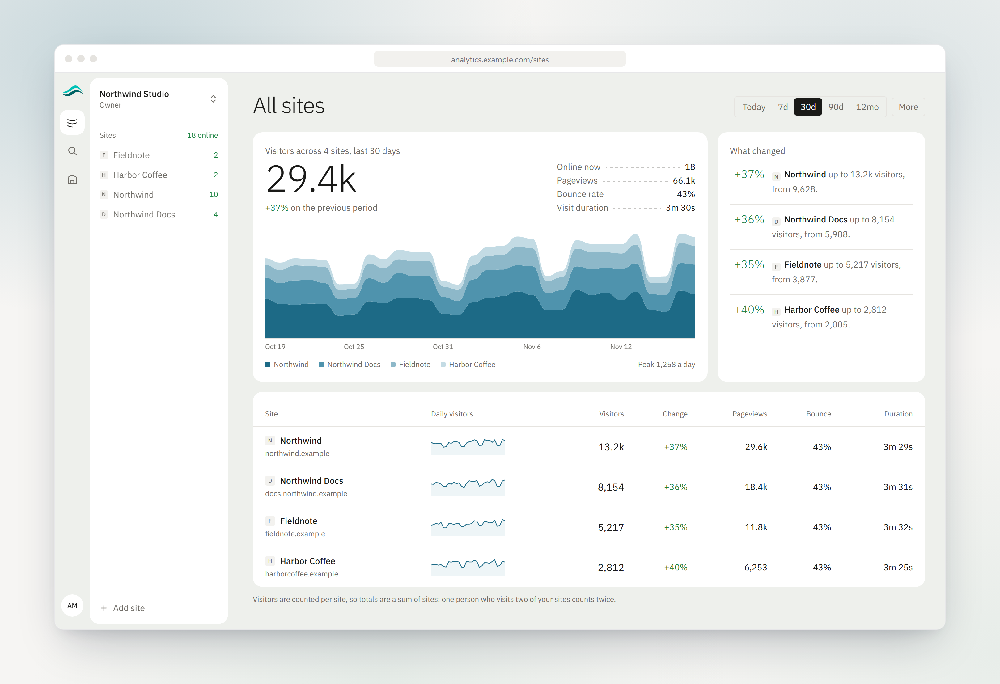
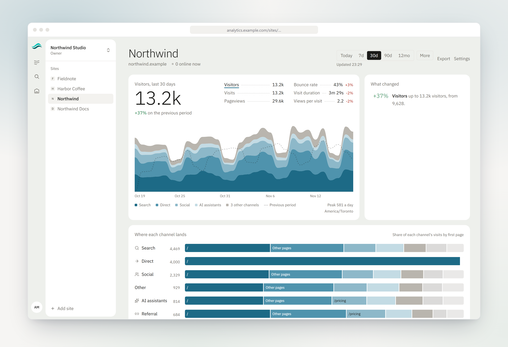
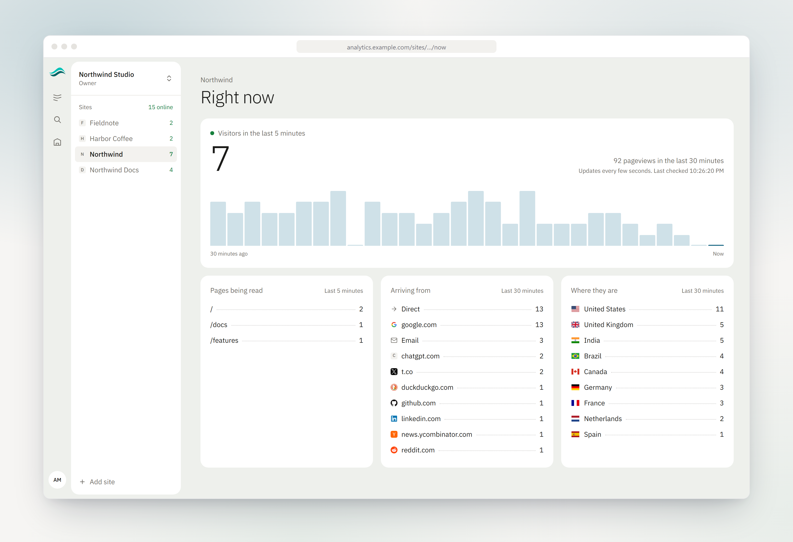
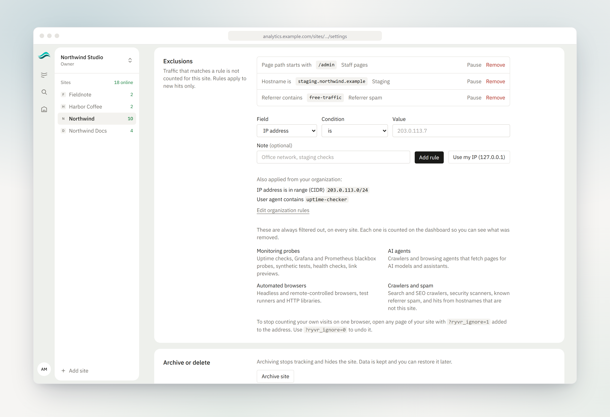
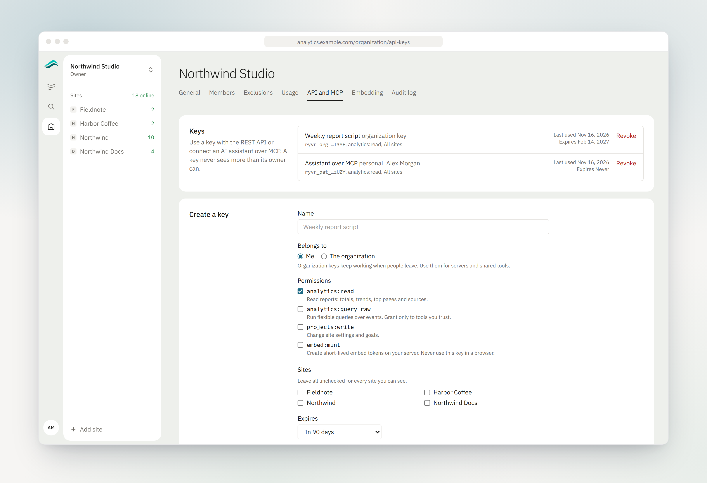

<p align="center">
  <picture>
    <source media="(prefers-color-scheme: dark)" srcset=".github/brand/ryvr-logo-on-dark.png">
    
  </picture>
</p>

<h1 align="center">RYVR <sup>beta</sup></h1>

<h3 align="center">Privacy-first web analytics for people who run more than one site.</h3>

<p align="center">
   ·
  <a href="docs/self-hosting.md"><b>Self-hosting</b></a> ·
  <a href="docs/tracking.md"><b>Tracking</b></a> ·
  <a href="docs/api.md"><b>API and MCP</b></a> ·
  <a href="CONTRIBUTING.md"><b>Contributing</b></a>
</p>

> [!WARNING]
> **RYVR is beta software.** Expect breaking changes to the database schema, the API and the tracker between releases, and missing features. It is not yet recommended for production-critical use. Keep backups and read the commit log before you upgrade.

<br>

<p align="center">
  <picture>
    <source media="(prefers-color-scheme: dark)" srcset=".github/screenshots/portfolio-dark.png">
    
  </picture>
</p>

## What is RYVR?

RYVR counts visits without cookies, filters out bots, AI agents and monitoring probes, and puts all of your sites side by side. Each organization can hold many sites, give clients access to only their own, and let AI assistants read the numbers over MCP.

It is a Laravel application backed by PostgreSQL, ClickHouse and Redis, and you host it yourself with Docker Compose. The tracker is one small script tag. RYVR does not build visitor profiles, follow people across sites or days, or store IP addresses.

<table>
<tr>
<td width="50%" valign="middle">

### A clean dashboard per site

Visitors, visits and pageviews against the previous period, what changed, where each channel lands, and pages, sources and audience in one view. Click any row to filter the whole dashboard by it.

[How tracking works](docs/tracking.md)

</td>
<td width="50%">
<picture>
  <source media="(prefers-color-scheme: dark)" srcset=".github/screenshots/site-dark.png">
  
</picture>
</td>
</tr>
<tr>
<td width="50%">
<picture>
  <source media="(prefers-color-scheme: dark)" srcset=".github/screenshots/now-dark.png">
  
</picture>
</td>
<td width="50%" valign="middle">

### Right now

Who is on the site in the last five minutes, which pages they are reading, where they came from and where they are. It refreshes on its own every few seconds.

</td>
</tr>
<tr>
<td width="50%" valign="middle">

### Traffic you can trust

Crawlers, AI agents, headless browsers, uptime checks and your own exclusion rules (IP ranges, user agents, paths, hostnames, referrers, countries) never reach your numbers, and the dashboard shows how much was filtered.

[Privacy and exclusions](docs/self-hosting.md#privacy)

</td>
<td width="50%">
<picture>
  <source media="(prefers-color-scheme: dark)" srcset=".github/screenshots/exclusions-dark.png">
  
</picture>
</td>
</tr>
<tr>
<td width="50%">
<picture>
  <source media="(prefers-color-scheme: dark)" srcset=".github/screenshots/api-dark.png">
  
</picture>
</td>
<td width="50%" valign="middle">

### API and MCP

A read-only REST API and an MCP server, both scoped by keys that never see more than their owner. Point an AI assistant at `/mcp` and ask what changed this week.

[REST API and MCP tools](docs/api.md)

</td>
</tr>
</table>

## Features

<table>
<tr>
<td width="33%" valign="top">

**Every site at once**

- Visitors, pageviews, bounce rate and duration for all sites
- Stacked trend and sparklines per site
- What changed: sites that rose, fell or went quiet
- Visitors online now, per site

</td>
<td width="33%" valign="top">

**Site dashboard**

- Pages, entry pages and exit pages
- Referrers, channels (including AI assistants), sources and campaigns
- Countries, cities, devices, browsers and OS
- Where each channel lands, by first page

</td>
<td width="33%" valign="top">

**Events and goals**

- Custom events with properties
- Revenue and currency on events
- Goals for a page or an event, with conversion rate
- Outbound links and file downloads, recorded on their own

</td>
</tr>
<tr>
<td width="33%" valign="top">

**Periods and filters**

- Today, 24 hours, 7, 30 and 90 days, 12 months and more
- Custom date ranges
- Comparison with the previous period
- Filter by any row; CSV export

</td>
<td width="33%" valign="top">

**Traffic you can trust**

- Crawlers, AI agents, monitoring probes and automated browsers filtered
- Referrer spam and unknown hostnames dropped
- Exclusion rules per site or organization, with notes and pause
- A count of what was kept out, on the dashboard

</td>
<td width="33%" valign="top">

**No cookies, no personal data**

- Visitors counted with a hash that changes every day
- IP addresses are never stored
- Optional consent mode in the tracker
- `?ryvr_ignore=1` to skip your own browser

</td>
</tr>
<tr>
<td width="33%" valign="top">

**Teams and clients**

- Owner, admin, analyst, viewer and billing roles
- Members limited to chosen sites or site groups
- Invitations and an audit log
- Two-factor authentication and passkeys

</td>
<td width="33%" valign="top">

**API and MCP**

- Read-only REST API under `/api/v1`
- MCP server over streamable HTTP at `/mcp`
- Personal and organization keys, limited by site and expiry
- Rate limited per key

</td>
<td width="33%" valign="top">

**Run it yourself**

- Docker Compose with automatic TLS through Caddy
- Health check at `/health`
- Configurable retention and free GeoIP updates
- About 1.4 KB tracker (gzipped) that works with single-page apps

</td>
</tr>
</table>

## Built with

<p>
  
  
  
  
  
  
  
  
</p>

## Quick start

Requires a Linux server with Docker and Docker Compose, and a hostname that points at it.

```bash
cp .env.production.example .env   # fill in the domain and passwords
docker compose up -d
```

Open your domain, create the first account, add a site and paste the tracking snippet into its `<head>`:

```html
<script
    defer
    src="https://analytics.example.com/r.js"
    data-key="ryvr_ingest_..."
></script>
```

```js
ryvr.track('Signup', { plan: 'pro' });
ryvr.track('Purchase', { sku: 'A1' }, { revenue: 49, currency: 'CAD' });
```

See [docs/self-hosting.md](docs/self-hosting.md) for the details, upgrades and backups. To work on RYVR itself, see [CONTRIBUTING.md](CONTRIBUTING.md).

## Learn more

|                  |                                                                           |
| ---------------- | ------------------------------------------------------------------------- |
| **Running**      | [Self-hosting](docs/self-hosting.md)                                      |
| **Using**        | [Tracking and events](docs/tracking.md) · [REST API and MCP](docs/api.md) |
| **Contributing** | [Develop, test and regenerate screenshots](CONTRIBUTING.md)               |

## Licence

The application is licensed under the [GNU AGPL v3](LICENSE). The tracker in `packages/tracker` is MIT licensed so it can be embedded anywhere.
